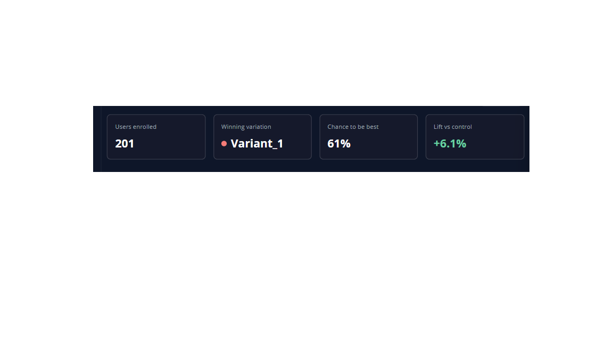

# Cricket Scorecard A/B Test

Does showing player stats first make more people open the full scorecard than showing the big score first?

This project tests that question with a Flagsmith experiment on a small, made-up T20 match page (India v Australia).

## How it works

- Flag: `scorecard_layout` splits visitors 50/50
  - Control (A): big score first
  - Variant_1 (B): top batter and bowler first
- Metric: `scorecard_click` (Occurrence), recorded when a visitor clicks "Full scorecard"
- Experiment: "Scorecard layout test" in Flagsmith, with the hypothesis that player stats first will raise the scorecard click rate

## Simulated traffic

All visitors and clicks are simulated. The page sends fake visitors through the real experiment, each with its own ID, and clicks are generated from made-up click rates set in the script. The results show that the experiment pipeline works, not that real fans prefer one layout.

## Files

- `cricket-ready.html`: the match page and the visitor simulator
- `results.png`: screenshot of the Flagsmith results

## Results

Flagsmith experiment "Scorecard layout test" (data as of 27 Nov 2026, 13:05 UTC). Two runs of 100 simulated visitors.

| Variant | Exposures | Click rate | Delta | 95% credible interval | Win probability |
|---|---|---|---|---|---|
| Control (big score first) | 102 | 33.3% | Baseline | Baseline | 39% |
| Variant_1 (player stats first) | 99 | 35.4% | +6.1% | [-34.7%, 46.8%] | 61% |

### How to read this

- Variant_1 is slightly ahead, but Flagsmith gives it only a 61% chance of being the better layout.
- The credible interval crosses zero, so with about 200 visitors we cannot say the layouts differ.
- Flagsmith shows "Winner Probability Confirmed", but 61% is far from a confident result. More visitors would be needed.
- The click rates were set by me in the script, so this shows the experiment works end to end, not what real fans prefer.
- The page's own table can differ from Flagsmith's, because the page shows only the latest run while Flagsmith counts both runs.

## What I learned

- Setting up a feature flag, a metric, and an experiment in Flagsmith
- Why small samples (100 visitors) swing a lot from run to run
- Results can take a while to appear in Flagsmith after events are accepted
